# ⚡ Detection of Electricity Theft Using Smart Meter Data with Random Forest and Isolation Forest

A complete pipeline for detecting **electricity theft** and **meter tampering** in a household using smart meter data:

1. **MATLAB / Simulink** simulate a smart-metered house (appliance loads, voltage, current, power, energy) and inject theft and tamper events. A simple hash chain ("blockchain layer") flags tampered readings.
2. A **MATLAB script** runs the model many times and exports a labelled dataset (`smart_meter_fin.xlsx` / `.csv`).
3. A **Google Colab notebook** trains a **Random Forest** (for supervised theft/tamper classification) and an **Isolation Forest** (for unsupervised anomaly detection). Both are **written from scratch in NumPy**.

| Result | Value |
|---|---|
| Theft_Label accuracy (Random Forest) | **90.1 %** |
| Tamper_Label accuracy | **95.5 %** |
| Tamper_Detected accuracy | **97.4 %** |
| Overall system accuracy | **94.3 %** |
| Anomalies flagged (Isolation Forest, top 10 %) | 398, of which 139 are theft cases |

---

## 📁 Repository Structure

```
├── Simulink files/
│   ├── ml_project.slx           # Top-level model (connects all subsystems)
│   ├── hour_day_season.slx      # Time generator: hour, day, season
│   ├── load_current.slx         # Household appliance load model
│   ├── energy_meter.slx         # Voltage, current, power, energy meter
│   ├── theft_noise_model.slx    # Sensor noise + theft/tamper injection
│   └── block_chain.slx          # Hash-chain tamper detection layer
├── ml_dataset.m                 # Runs ml_project 40× and exports the dataset
├── smart_meter_fin.xlsx         # Generated dataset (20,040 rows × 13 columns)
├── energy_meter_ml.ipynb        # Colab notebook: EDA + Random Forest + Isolation Forest
├── ML_POSTER.pdf                # Project poster
├── Detection of Electricity Theft ... Techniques.pdf   # Project report
└── images/                      # Figures used in this README
```

---

## 🏗️ System Architecture

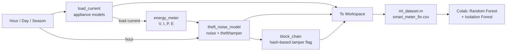

---

## 🔧 Part 1: Simulink Model

### Top-level model: `ml_project.slx`
The Hour, Day and Season constants (`Hour_in_val`, `Day_in_val`, `Season_in_val`) are set from the MATLAB workspace. They feed four referenced subsystems in series. All signals are muxed into a **To Workspace** block (`simout`) and a Scope.

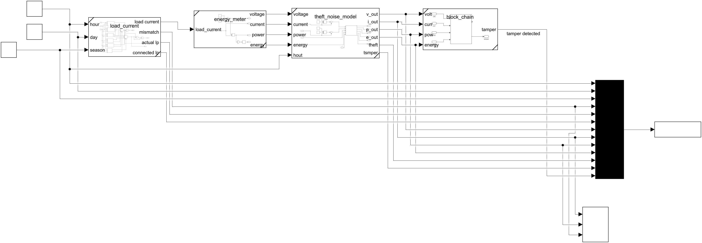

### `hour_day_season.slx`: Time & season generator
A Clock is converted to hours (`× 1/3600`), wrapped with `mod 24`, and divided by 24 to get the day. A MATLAB Function then sets the season with a 270-day cycle: **1 = Summer**, **2 = Rainy**, **3 = Winter** (90 days each).

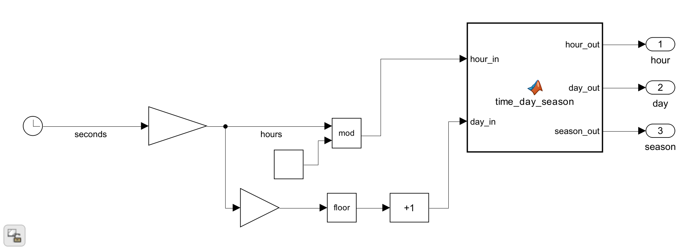

### `load_current.slx`: Household load model
Six MATLAB Function blocks model each appliance's **connected load** (`P_conn`) and **actual load** (`P_act`). They use time of day, season and weekday/weekend behaviour, plus random variation, rare OFF states, spikes and noise:

| Appliance | Behaviour |
|---|---|
| AC (×2) | 1500 W (12–18 h), 1200 W (20–23 h), else 200 W; scaled ×1.4 summer / ×1.0 rainy / ×0.5 winter |
| Lights | 100 W at night (18–6 h), 20 W in the day |
| Fridge | 150 W constant with compressor cycling and +5 % in summer |
| Washing machine | 500 W, used 8–20 h (20 % chance on weekends, 8 % on weekdays) |
| TV | 120 W in the evening (18–23 h), 20 W standby |

Outputs: **load current** = ΣP_act / 230, **mismatch ratio** = (P_conn − P_act) / P_conn, actual load and connected load.

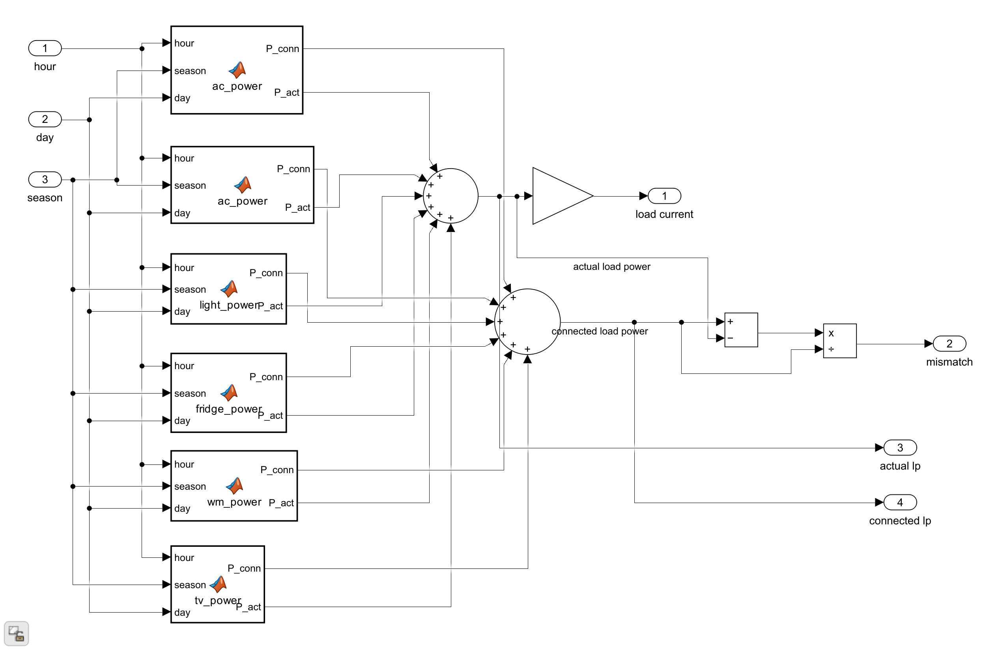

### `energy_meter.slx`: Smart meter
The supply voltage is 230 V plus a slow ±10 V daily sine variation. Power = V × I. Energy (kWh) comes from a discrete-time integrator with gain `1/(3600·1000)`.

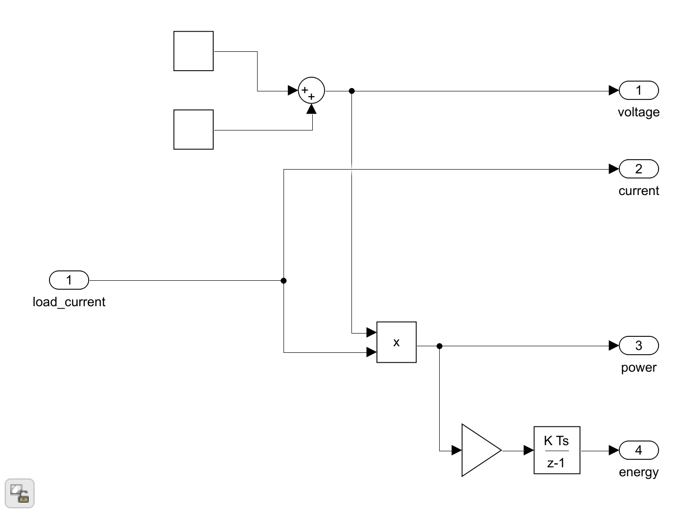

### `theft_noise_model.slx`: Noise & theft injection
Random-number noise (2 %) is added to voltage and current. The `theft_model` MATLAB Function then injects these events:

| Label | Type | Effect |
|---|---|---|
| `theft = 1` | Partial theft (10 %) | Current reduced to 60 % |
| `theft = 2` | Full bypass (5 %) | Current = 0 |
| `theft = 3` | Night theft (22:00–05:00, 10 %) | Current reduced to 50 % |
| `tamper = 1` | Data tampering (5 %) | Power reading perturbed by ±200·randn |

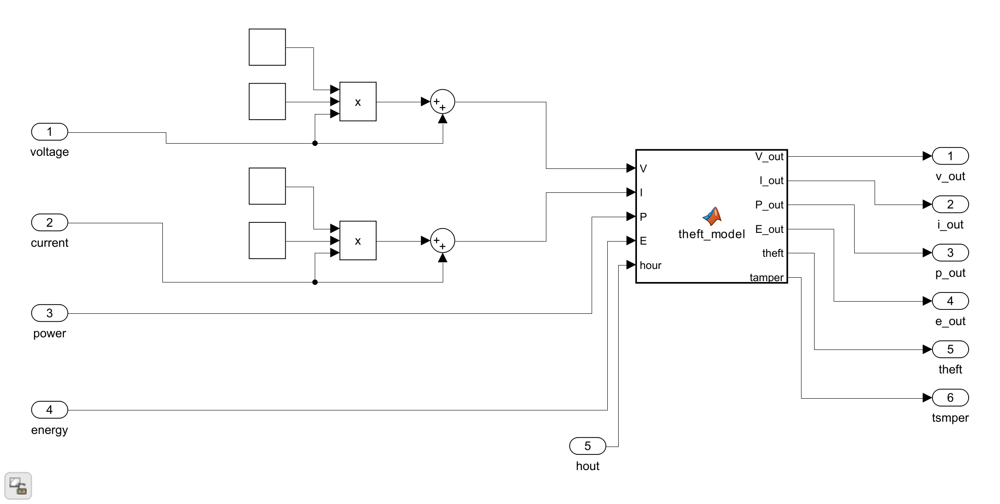

### `block_chain.slx`: Hash-chain tamper detection
A lightweight blockchain-style layer chains each reading to the previous one:

```matlab
current_hash = mod(abs(V*31 + I*17 + P*13 + E*7 + prev_hash), 1e6);
tamper_flag  = abs(current_hash - prev_hash) > 1e5;
```

A sudden jump in the hash chain sets `Tamper_Detected = 1`.

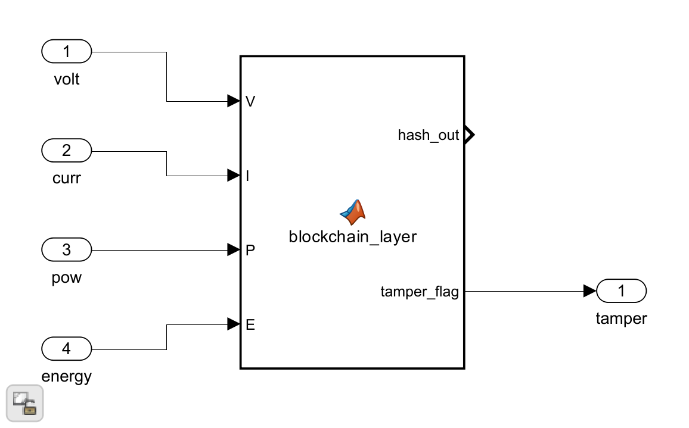

---

## 📊 Part 2: Dataset Generation (`ml_dataset.m`)

The script runs `ml_project` **40 times** (50 s each, step 0.02 s). Each run uses a random hour (0–23), day (1–30) and season (1–3), which gives about 20,000 samples. The results are exported to `smart_meter_fin.csv`, `smart_meter_fin.xlsx` and `smart_meter_data.mat`.

**Dataset columns (20,040 rows × 13):**

| Features (X) | Targets (Y) |
|---|---|
| Hour, Day, Season, Mismatch_Ratio, Actual_load, Connected_load, Voltage, Current, Power, Energy | Theft_Label (0–3), Tamper_Label (0/1), Tamper_Detected (0/1) |

---

## 🤖 Part 3: Machine Learning (Google Colab: `energy_meter_ml.ipynb`)

### Exploratory Data Analysis

| Power | Voltage Variation |
|---|---|
| 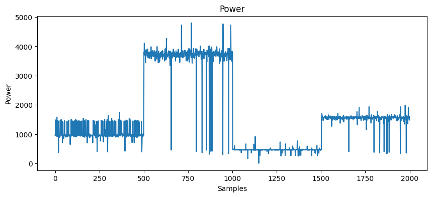 | 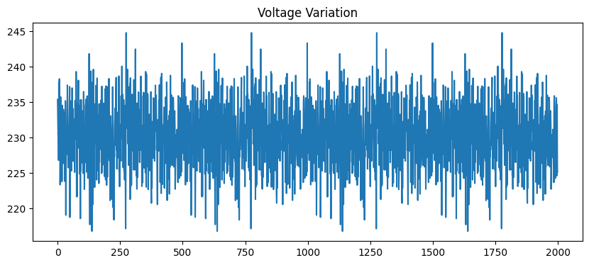 |

| Mismatch Ratio | Mismatch Ratio Distribution |
|---|---|
| 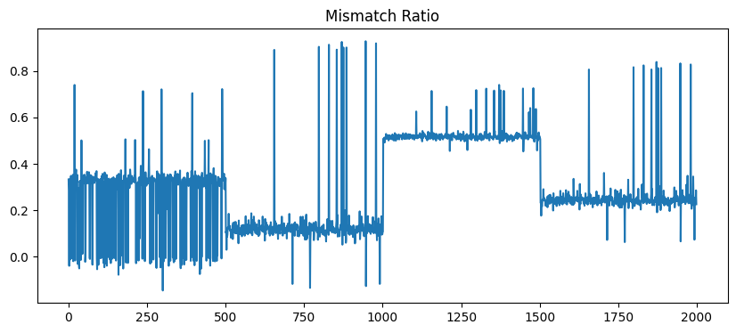 | 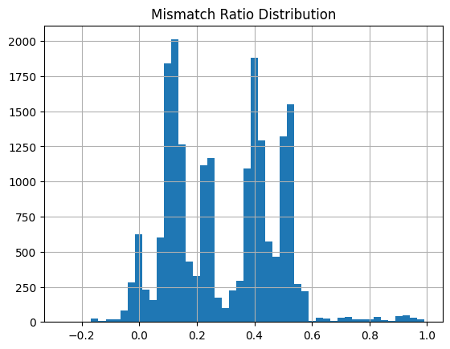 |

| Theft Label Distribution | Feature Correlation |
|---|---|
| 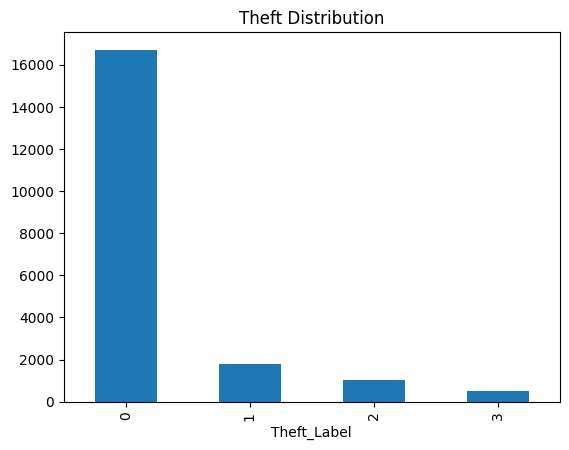 | 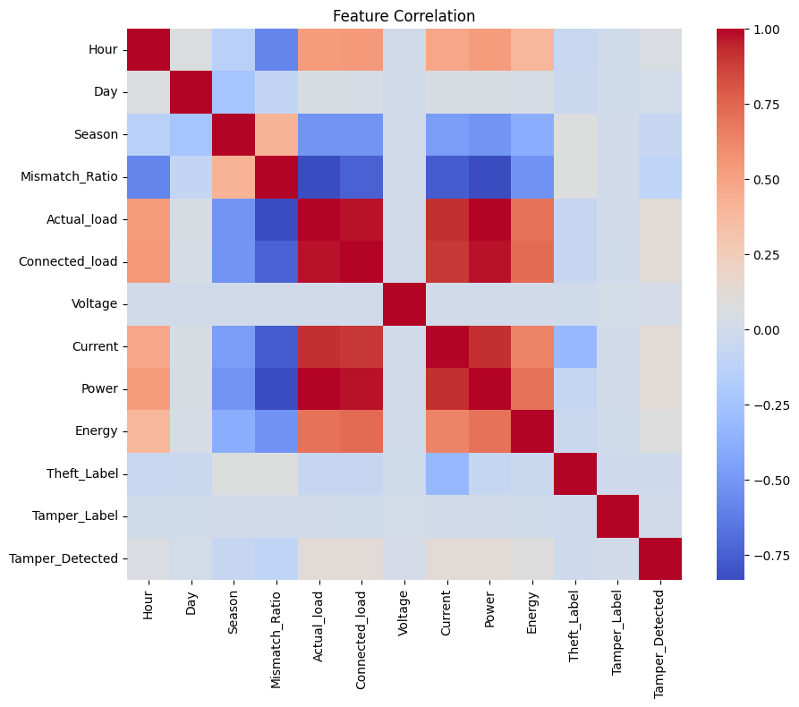 |

### Random Forest (from scratch)
- **Gini impurity** splitting, with 10 candidate thresholds per feature
- **Feature subsampling**: √(n_features) features are tried at each split
- **Bootstrap sampling**, 5 trees, max depth 3
- **Majority voting** across trees
- Three separate forests are trained for `Theft_Label`, `Tamper_Label` and `Tamper_Detected` (80/20 train/test split)

```
Theft_Label Accuracy:     0.9009
Tamper_Label Accuracy:    0.9551
Tamper_Detected Accuracy: 0.9736
Overall System Accuracy:  0.9432
```

| Accuracy Comparison | Theft: Predicted vs Actual |
|---|---|
| 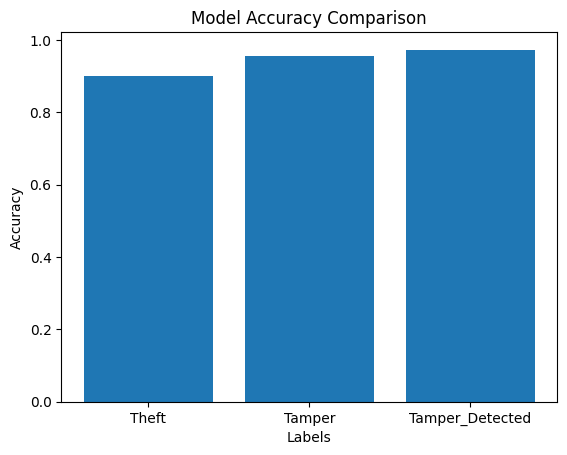 | 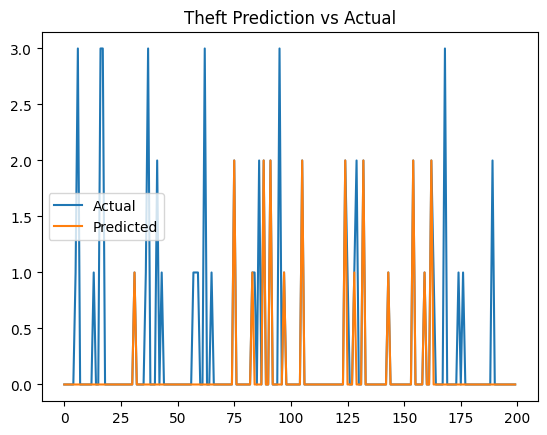 |

| Confusion Matrix (Theft) | Feature Importance |
|---|---|
| 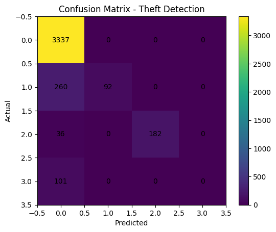 | 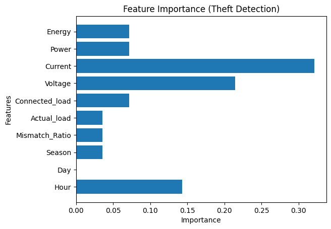 |

Feature importance is measured by how often each feature is used in a split. **Mismatch_Ratio** and the load features are the strongest indicators of theft.

### Isolation Forest (from scratch)
- 25 isolation trees, each built on 256 random samples, max depth 8
- Anomaly score = 2^(−average path length)
- Threshold = 90th percentile of the scores

```
Anomalies Detected:            398
Theft cases inside anomalies:  139
Tamper cases inside anomalies: 13
Anomaly Precision (Theft):     0.349
```

| Anomaly Score Distribution | Detection Threshold |
|---|---|
| 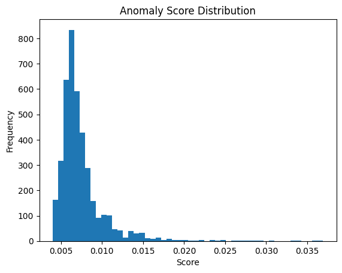 | 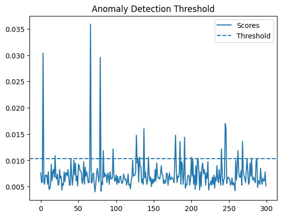 |

| Anomaly vs Normal | Breakdown of Detected Anomalies |
|---|---|
| 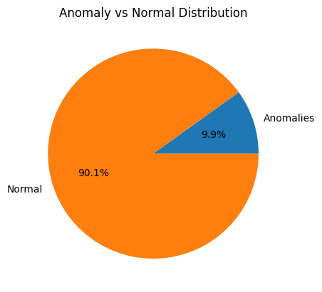 | 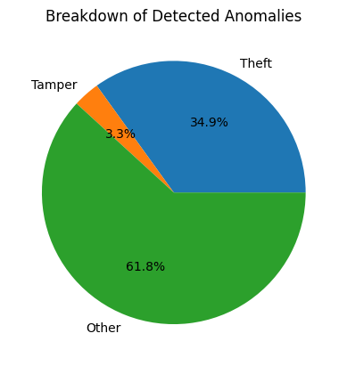 |

---

## ▶️ How to Run

### 1. Generate the dataset (MATLAB + Simulink)
1. Open MATLAB and set the working folder to `Simulink files/`. Put `ml_dataset.m` on the path or copy it into that folder.
2. Run:
   ```matlab
   ml_dataset
   ```
3. This creates `smart_meter_fin.csv`, `smart_meter_fin.xlsx` and `smart_meter_data.mat`.

> Requires MATLAB/Simulink with Stateflow, which the MATLAB Function blocks need. The models were built with R2025b.

### 2. Train the models (Google Colab)
1. Open `energy_meter_ml.ipynb` in [Google Colab](https://colab.research.google.com/).
2. Run the first cell and upload `smart_meter_fin.csv`. If you only have the `.xlsx`, export it as CSV first.
3. Run all cells.

Python dependencies: `pandas`, `numpy`, `matplotlib`, `seaborn`, `scikit-learn` (used only for `confusion_matrix`).

---

## ✅ Conclusion

- **Random Forest** classifies theft and tampering accurately: 94.3 % overall accuracy.
- **Isolation Forest** finds unusual consumption patterns without needing labels, so it can catch new or unseen fraud.
- The **hybrid approach** (supervised + unsupervised + hash-chain integrity check) makes the system more reliable.

**Limitations**
- The theft confusion matrix has 0 false positives but 260 false negatives, so many theft cases are missed. The shallow trees (depth 3, 5 trees) are a main reason.
- The anomaly detector has false positives: its precision for theft is 35 %.
- The dataset is synthetic and may not capture real-world complexity.

**Future scope**
- Real-time integration with physical smart meters
- Deployment on embedded platforms such as the ESP32
- Deeper or more trees, class balancing, and advanced models (XGBoost, LSTM autoencoders)

---

## 📄 Documents
- 📑 [Project Report (PDF)](Detection%20of%20Electricity%20Theft%20Using%20Smart%20Meter%20Data%20with%20Random%20Forest%20and%20Isolation%20Forest%20Techniques.pdf)
- 🖼️ [Project Poster (PDF)](ML_POSTER.pdf)
